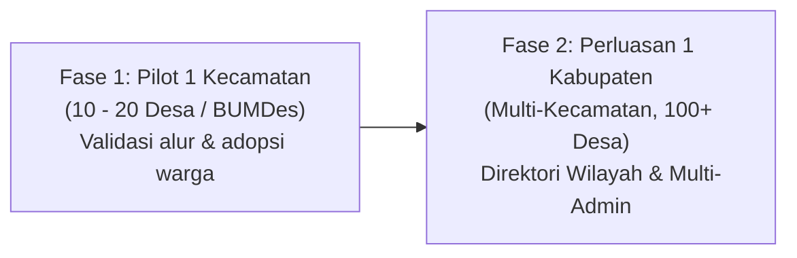

# Blueprint Arsitektur: Platform Katalog & Pemesanan Multi-Desa
> **Referensi Awal:** Proyek `abunawas-store` (React 19 + Tailwind CSS v4 + WhatsApp Direct Order)  
> **Target Evolusi:** Platform Multi-Tenant E-Katalog Sembako & UMKM Tingkat Kecamatan hingga Kabupaten berbasis **Supabase** & **Vercel Free Tier**.

---

## 1. Ringkasan Eksekutif & Visi Proyek

Proyek ini merupakan evolusi dari **Abunawas Store** (katalog toko tunggal berbasis Google Sheets) menjadi platform **Multi-Tenant E-Katalog** yang dapat melayani banyak desa dalam satu kecamatan maupun diperluas hingga tingkat kabupaten.

Setiap desa (BUMDes, Koperasi Desa, atau Komunitas UMKM) memiliki etalase digital mandiri untuk menjual produk sembako dan kebutuhan harian warga, dengan pemesanan terintegrasi langsung ke WhatsApp pengelola masing-masing desa.

---

## 2. Analisa Kelayakan & Batasan Free Tier

Sistem ini didesain agar dapat beroperasi pada **biaya server Rp 0 (100% Free Tier)** menggunakan **Vercel** dan **Supabase**.

### A. Supabase Free Tier
* **Database (PostgreSQL):** Jatah **500 MB**.
  * Rata-rata 1 baris produk teks = ~0.5 KB.
  * Jika ada **400 desa** masing-masing memiliki **50 produk** = 20.000 produk. Total kapasitas database yang terpakai hanya **~10 - 25 MB** (< 5% batas gratis).
* **API Requests:** Tidak dibatasi kuota bulanan (Fair Use ~500 req/detik).
* **Supabase Auth (Admin Desa):** Kuota **50.000 Monthly Active Users (MAU)**. Sangat mencukupi untuk login puluhan hingga ratusan admin BUMDes.
* **Storage Gambar & Egress (5 GB/bulan):**
  * *Strategi Optimasi:* Gambar produk dikompresi ke format modern (.webp) dengan ukuran < 150 KB, atau tetap memanfaatkan CDN eksternal gratis (Cloudinary Free / link Google Drive seperti yang sudah diterapkan di `abunawas-store`).
* **Supabase Inactivity Pause (Sleep setelah 7 hari tanpa request):**
  * Karena 1 database dipakai bersama oleh banyak desa, **selama ada 1 pengunjung di salah satu desa dalam 7 hari, database tidak akan pernah tidur (sleep)**.

### B. Vercel Free Tier (Hobby)
* **Bandwidth:** Jatah **100 GB / bulan**.
  * File aplikasi React (SPA) yang di-build berukuran sangat kecil (~150 KB gzipped). 100 GB sanggup melayani **> 500.000 kunjungan per bulan**.
* **Edge CDN Serving:** Seluruh aset frontend disajikan statis melalui Vercel Edge Network di seluruh dunia dengan latensi sangat rendah.

---

## 3. Strategi Pentahapan (Rollout Strategy)



### Rekomendasi:
1. **Mulai dari Skala 1 Kecamatan:**
   * Sembako adalah komoditas dengan radius pengiriman dekat (ongkir murah, cepat sampai).
   * Memudahkan koordinasi dengan kepala desa / pengurus BUMDes setempat.
2. **Desain Database Langsung Skala Kabupaten:**
   * Struktur database sejak awal sudah memiliki kolom `kecamatan` dan `desa`, sehingga ketika berekspansi ke kecamatan lain, tidak perlu merombak skema database.

---

## 4. Arsitektur Multi-Tenancy & Navigasi Pengguna

Terdapat 2 opsi arsitektur navigasi yang dapat diterapkan:

### Model A: URL Path Routing (Sangat Disarankan)
* Format URL: `katalogdesa.id/:kecamatan/:desa` atau `katalogdesa.id/:desa`
  * Contoh: `katalogdesa.id/sukamaju` atau `katalogdesa.id/karangsari`
* Pengunjung yang membuka alamat utama (`katalogdesa.id`) akan diarahkan ke **Halaman Direktori/Pencarian Desa**.

### Model B: Selector Lokasi (Gaya Aplikasi Belanja)
* Pengunjung membuka website umum, lalu memilih desanya melalui modal/dropdown lokasi pada Navbar.
* Pilihan desa disimpan pada `localStorage` browser sehingga saat kunjungan berikutnya, katalog desa tersebut langsung terbuka otomatis.

---

## 5. Perancangan Skema Database (Supabase PostgreSQL DDL)

Berikut rancangan tabel siap pakai untuk Supabase:

```sql
-- 1. TABEL KECAMATAN
CREATE TABLE subdistricts (
    id UUID PRIMARY KEY DEFAULT gen_random_uuid(),
    name VARCHAR(100) NOT NULL,
    slug VARCHAR(100) UNIQUE NOT NULL,
    created_at TIMESTAMPTZ DEFAULT NOW()
);

-- 2. TABEL DESA / BUMDES (TENANT)
CREATE TABLE villages (
    id UUID PRIMARY KEY DEFAULT gen_random_uuid(),
    subdistrict_id UUID REFERENCES subdistricts(id) ON DELETE CASCADE,
    name VARCHAR(100) NOT NULL,
    slug VARCHAR(100) UNIQUE NOT NULL,
    business_name VARCHAR(150) NOT NULL,       -- Contoh: BUMDes Sukamaju Berkah
    whatsapp_number VARCHAR(20) NOT NULL,      -- Format 628xxxxxxxx
    address TEXT,                              -- Alamat fisik toko
    gmaps_url TEXT,
    logo_url TEXT,
    primary_color VARCHAR(10) DEFAULT '#15803d', -- Identitas warna khas tiap desa
    opening_hour TIME DEFAULT '07:00',
    closing_hour TIME DEFAULT '20:00',
    free_delivery_min NUMERIC DEFAULT 0,       -- Minimal belanja gratis ongkir
    delivery_note TEXT,                        -- Info jangkauan antar desa
    is_active BOOLEAN DEFAULT TRUE,
    created_at TIMESTAMPTZ DEFAULT NOW()
);

-- 3. TABEL KATEGORI PRODUK
CREATE TABLE categories (
    id UUID PRIMARY KEY DEFAULT gen_random_uuid(),
    village_id UUID REFERENCES villages(id) ON DELETE CASCADE,
    name VARCHAR(50) NOT NULL,
    sort_order INT DEFAULT 0
);

-- 4. TABEL PRODUK
CREATE TABLE products (
    id UUID PRIMARY KEY DEFAULT gen_random_uuid(),
    village_id UUID REFERENCES villages(id) ON DELETE CASCADE,
    category_id UUID REFERENCES categories(id) ON DELETE SET NULL,
    name VARCHAR(150) NOT NULL,
    description TEXT,
    price NUMERIC NOT NULL,
    original_price NUMERIC,                    -- Harga coret / sebelum diskon
    unit VARCHAR(30) DEFAULT 'pcs',            -- kg, karung, botol, liter, ikat
    stock_status VARCHAR(20) DEFAULT 'ready',  -- 'ready', 'pre-order', 'habis'
    image_url TEXT,
    is_featured BOOLEAN DEFAULT FALSE,         -- Produk unggulan desa
    created_at TIMESTAMPTZ DEFAULT NOW(),
    updated_at TIMESTAMPTZ DEFAULT NOW()
);

-- 5. ROW LEVEL SECURITY (RLS) POLICIES
ALTER TABLE subdistricts ENABLE ROW LEVEL SECURITY;
ALTER TABLE villages ENABLE ROW LEVEL SECURITY;
ALTER TABLE categories ENABLE ROW LEVEL SECURITY;
ALTER TABLE products ENABLE ROW LEVEL SECURITY;

-- Publik (Pembeli): Boleh membaca semua data aktif
CREATE POLICY "Public can read subdistricts" ON subdistricts FOR SELECT USING (true);
CREATE POLICY "Public can read active villages" ON villages FOR SELECT USING (is_active = true);
CREATE POLICY "Public can read categories" ON categories FOR SELECT USING (true);
CREATE POLICY "Public can read products" ON products FOR SELECT USING (true);
```

---

## 6. Fitur Unggulan Aplikasi Pembeli (Frontend UX)

Diadaptasi dan disempurnakan dari komponen `abunawas-store`:

1. **Multi-Item Shopping Cart (Keranjang Belanja):**
   * Pelanggan dapat memilih beberapa produk sekaligus (contoh: 2 karung beras, 1 minyak, 3 sabun).
   * Floating Cart Bar di bagian bawah layar menampilkan counter item dan total rupiah secara *real-time*.

2. **Formulir Checkout Kilat (Drawer Modal):**
   * Sebelum diarahkan ke WhatsApp, pembeli mengisi formulir ringkas:
     * Nama Penerima
     * Alamat Lengkap / Patokan RT-RW di desa
     * Opsi Pengantaran: *Diantar ke Rumah* atau *Ambil Sendiri di BUMDes*
     * Metode Pembayaran: *Tunai / COD saat sampai* atau *Transfer / QRIS*
     * Catatan khusus

3. **Format Pesanan WhatsApp Otomatis:**
   * Hasil checkout otomatis membuka WhatsApp admin desa tujuan dengan format teks terstruktur:
     ```text
     Halo BUMDes Sukamaju Berkah, saya ingin memesan:
     ----------------------------------------
     1. Beras Pandan Wangi 5kg (1x) : Rp 72.000
     2. Minyak Goreng 2L (2x)       : Rp 68.000
     3. Gula Pasir 1kg (1x)         : Rp 17.500
     ----------------------------------------
     Total Belanja : Rp 157.500

     *Data Pengiriman:*
     - Nama       : Ibu Siti
     - Alamat     : RT 03 RW 02 (Samping Posyandu)
     - Pengiriman : Diantar ke Rumah
     - Pembayaran : Bayar di Tempat (COD)
     ----------------------------------------
     Mohon konfirmasi ketersediaan barang. Terima kasih!
     ```

4. **Fitur Filter & Sorting Cerdas:**
   * Pencarian multi-kata (fuzzy search).
   * Filter per kategori dinamis.
   * Urutkan berdasarkan: *Harga Termurah*, *Harga Termahal*, *Nama (A-Z)*, dan *Produk Tersedia Dahulu*.

5. **Indikator Jam Buka / Tutup Toko:**
   * Menghitung status operasional berdasarkan waktu lokal pembeli dan jam operasional BUMDes.
   * Menampilkan label:
     * 🟢 *Buka (Siap Antar)*
     * 🔴 *Tutup (Buka Pukul 07.00 - Pesanan WA tetap diterima dan diproses besok)*

---

## 7. Panel Pengelola Desa (BUMDes Simple Admin)

Agar tiap desa mandiri memperbarui harga dan stok tanpa butuh bantuan programmer:
* Halaman Admin berbasis web (`katalogdesa.id/admin`).
* Login menggunakan **Supabase Auth** (email & password untuk masing-masing pengurus BUMDes).
* Row Level Security (RLS) memastikan Admin Desa A hanya bisa menambah/mengubah produk milik Desa A.
* Fitur admin:
  * Tambah / Edit / Hapus produk.
  * Saklar cepat ganti status stok: `Tersedia` / `Habis`.
  * Upload foto produk via kamera HP.
  * Ubah harga sembako harian.

---

## 8. Panduan Memulai Proyek Baru (Kick-off Checklist)

Ketika memulai proyek baru dengan referensi dari `abunawas-store`:

1. **Inisialisasi Project:**
   ```bash
   npm create vite@latest katalog-multi-desa -- --template react
   cd katalog-multi-desa
   npm install @supabase/supabase-js react-router-dom lucide-react
   npm install tailwindcss @tailwindcss/vite
   ```

2. **File & Komponen yang Dapat Diadaptasi Langsung:**
   * [helpers.js](src/utils/helpers.js): Fungsi `formatRupiah()`, `driveImageUrl()`, dan formula `buildWhatsAppUrl()`.
   * [ProductCard.jsx](src/components/ProductCard.jsx): Struktur tampilan kartu, badge ketersediaan stok, dan handling error gambar.
   * [FilterBar.jsx](src/components/FilterBar.jsx): Logika pencarian input dan tab filter kategori.
   * [index.css](src/index.css): Token desain tema dinamis berbasis CSS variable `--primary`.

3. **Pengaturan Environment Variables (`.env`):**
   ```env
   VITE_SUPABASE_URL=https://xxxxxxxxxxxxxx.supabase.co
   VITE_SUPABASE_ANON_KEY=eyJhbGciOiJIUzI1NiIsInR5cCI6IkpXVCJ9...
   ```

4. **Deployment:**
   * Hubungkan repository GitHub ke **Vercel**.
   * Masukkan Environment Variables di dashboard Vercel.
   * Setup selesai, website siap online dan gratis selamanya.

